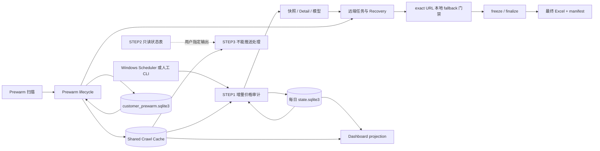
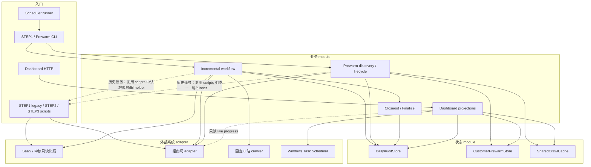

# CNNC 系统地图

> 这是一张优先导航图，不是真理。先用它缩小范围，再用当前代码、SQLite、外部系统回读和测试确认根因；地图解释不了时，可以扩大搜索范围。

主要读者是第一次接触 CNNC 的用户和 AI。遇到故障先去 [Bug 排查说明书](docs/debug/BUG_ROUTING.md)，遇到“哪个状态可信”先去 [状态归属说明](docs/debug/STATE_OWNERSHIP.md)。具体生产步骤仍以 `AGENTS.md` 和对应 runbook 为准。

## 一句话全景

CNNC 不是一条自动跑到底的流水线。STEP1 持续取得待审数据、补证据并生成最终价格审计表；Prewarm 提前准备客户参考链接；STEP2 是独立的只读监控导出；STEP3 只处理用户指定的 STEP2 结果。Dashboard 只把这些状态投影给人看，不能替代状态权威。

## 主要 module

| Module | 用通俗中文解释 | 稳定入口或第一阅读点 |
|---|---|---|
| Scheduler / CLI | Windows 计划任务按时唤醒有限命令；CLI 只负责解析参数和接线。 | `scripts/run_incremental_price_audit_scheduled.ps1`、`scripts/incremental_price_audit.py` |
| STEP1 增量价格审计 | 取得 SaaS/中核快照，推进 Detail、模型、爬价、冻结和最终交付。 | `app/workflows/incremental_price_audit.py` |
| Runtime 接线 | 组装依赖、命令预算、writer lock、BATCH_STATE 兼容投影和各恢复入口。它当前仍较宽，是已知历史债务，不是本任务要重构的对象。 | `app/services/incremental_audit_runtime.py` |
| Daily Audit Store | 保存某一业务日可恢复的 STEP1 checkpoint、远端任务、crawl、freeze/finalize 证据。 | `app/services/daily_audit_store.py`、每日 `state.sqlite3` |
| Prewarm | 提前发现客户参考链接，复用缓存或派发有限远端任务，减少后续等待；跨天 lifecycle 继续对账和回收旧任务。 | `customer_prewarm_*` modules、`customer_prewarm.sqlite3` |
| Remote Execution / 招商局 | 把不可控的外部建任务、进度、导出和 Priority 契约包在 adapter 后；所有写入都受身份和授权门禁约束。 | `app/services/legacy_zhaoshang_adapter.py`、`batch_zhaoshang_adapter.py` |
| Recovery | 对已有 durable identity 做对账、回收、有限恢复；核心目标是避免重复创建和猜测远端结果。 | `app/services/recovery/`、`remote_running_recovery.py` |
| Local Fallback | 只对满足时间、站点、exact URL、最终远端检查和预算门禁的缺价链接运行固定 8 站兜底。 | `app/services/incremental_local_fallback.py` |
| Finalize | 冻结权威 snapshot，构造最终行，写 Excel 和 manifest，再原子登记最终证据。 | `incremental_audit_closeout.py`、`incremental_price_audit_finalize.py`、`incremental_audit_materializer.py` |
| Shared Crawl Cache | 跨业务日保存 URL 身份和 append-only 成功爬取证据，供 STEP1/Prewarm/STEP3 复用。 | `app/services/shared_crawl_cache.py`、`shared_crawl_cache.sqlite3` |
| STEP2 | 只读查询中核待处理和 SaaS 监控，生成状态工作簿；不会自动进入 STEP3。 | `scripts/export_current_monitor_status.py` |
| STEP3 | 处理用户指定监控表中不能直接推送的数据，先读缓存，再按授权走招商局或窄 fallback。 | `scripts/process_monitor_no_push_zhaoshang.py`、`step3_prewarm_cache.py` |
| Dashboard | 从 SQLite、便利快照、Task Scheduler 和只读远端观测生成页面；它是 projection，不是业务状态权威。 | `app/dashboard_api.py`、`dashboard_projection.py`、`prewarm_dashboard_projection.py` |

## 图 1：当前业务流程

虚线表示用户明确选择后才进入下一步，不是自动调用。Prewarm 与 STEP1 共用远端能力和缓存，但各自有身份与生命周期门禁。

## 图 2：谁可以调用谁

调用方向的目标是“入口 -> 业务 module -> 状态 module / 外部 adapter”。当前 `app -> scripts` 和 Runtime 承担过多接线属于已知历史债务；本图只诚实标注，不在 ARCH-02A 里改动。

## 高风险区域

| 区域 | 为什么危险 | 排查时的硬规则 |
|---|---|---|
| 招商局真实创建 | `/add` 可能产生无法安全重试的真实任务。 | 先查 durable intent 和 exact remote identity；未知结果进入 `SUBMIT_UNKNOWN`，禁止盲目重发。 |
| Priority | taskNumber 不是唯一身份，宽范围更新会伤及别的任务。 | 只用受控工具、精确 task id 集和回读；`affected_rows>0` 才叫本次提优。 |
| `SUBMIT_UNKNOWN` | 可能已经远端成功，也可能没有；本地无法凭超时判断。 | 只读 reconcile exact identity；不再次 POST。 |
| RUNNING stall / restart | 远端只是慢，不等于卡死；重复 restart 会扩大事故。 | 先看 live progress 与 durable recovery evidence；最多走既有单次精确恢复。 |
| freeze / finalize | 最终表必须来自固定 snapshot 和可验证 manifest，不能从后续可变数据重算。 | 先检查 SQLite finalization intent、metrics、workbook/manifest hash。 |
| 本地 fallback | 会访问外部商城，并可能遇到验证码、登录墙或风控。 | 只允许固定站点、exact URL、原子 claim、最终远端检查和有界预算；失败保留远端证据。 |
| SaaS 写操作 | 审批、驳回、通过、补推都是真实业务写。 | 仅按 `AGENTS.md` 的窄例外和二次授权执行；排查不得顺手写。 |
| Dashboard 操作入口 | 页面既有只读 projection，也有少量受控人工命令。 | 显示不等于权威；任何操作仍必须通过 loopback、action token、身份和业务门禁。 |

## 状态怎么读

最短规则：STEP1 当日业务状态先信每日 `state.sqlite3`；Prewarm 候选归属先信 `customer_prewarm.sqlite3`；缓存内容先信 `shared_crawl_cache.sqlite3`；Dashboard、`daily_status.json`、`BATCH_STATE.md` 都是投影或交接证据。跨库或远端冲突的完整处理见 [STATE_OWNERSHIP.md](docs/debug/STATE_OWNERSHIP.md)。

## 多个 AI 同时开发

1. 每个任务使用独立 worktree 和 branch，不在 `cnnc-prod-runtime` 开发。
2. 开始前 `git fetch origin`，记录 `BASE_SHA=origin/prod/closeout-20260818`。
3. 提交前再次 fetch；若正式 prod moved，必须阅读新增 commits，复核本任务引用的事实并重新测试。
4. 同一区域冲突时生产 Bug 优先，架构治理让路。
5. worktree、branch、PR、merge、deploy 是不同状态；不能互相冒充。

## 这三份导航为什么分开

- 本文件回答“系统有哪些主要 module、调用方向和风险”。
- `BUG_ROUTING.md` 回答“用户看到某个现象后先查哪里”。
- `STATE_OWNERSHIP.md` 回答“信息冲突时谁是 System of Record”。

通过 deletion test：删除任一份都会把对应知识重新散回大量 runbook、代码和测试；三份文档没有复制同一张明细表，因此各自提供独立 leverage 和 locality。
