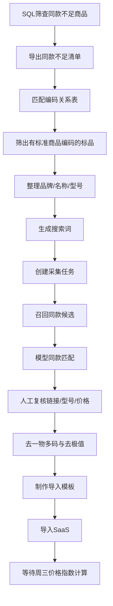

# 中核监控商品同款不足数据筛查和线下流程补同款

> 适用频率：每周工作，建议周一启动，周三前完成。  
> 适用对象：已纳入中核监控商品池但有效同款不足2条的标准商品。  
> 目标结果：筛出同款不足商品，补充至少2条不同商城有效同款，完成去一物多码/去极值处理并导入SaaS，保障周三价格指数计算可正常进行。

## 1. 总体流程



## 2. 第一步：SQL筛查同款不足商品

每周一或周二执行SQL，导出当前中核商品池中有效同款不足2条的监控商品。

```sql
select CONCAT(a.commodity_id,'\t') '监控商品编码',a.commodity_name '监控商品名称',(case when total <1 then '无上架同款' else '仅有一条上架同款' end ) as '同款异常情况',
r.DEST_SHOP_CODE '同款商城编码',r.DEST_SKU_ID '同款商品编码',r.COMMODITY_NAME '同款商品名称'
 from
(
SELECT 
    c1.my_commodity_id, 
    c1.commodity_id,
        c1.COMMODITY_NAME,
    COUNT(a.SRC_MY_COMMODITY_ID) as total
FROM saas_onecode_price.commodity_pool_188605 c1
LEFT JOIN (
    SELECT 
        r.SRC_COMMODITY_POOL_ID,
        r.src_my_commodity_id 
    FROM saas_onecode_price.commodity_pool_relation_188605 r 
    JOIN saas_onecode_price.monitor_commodity_price_last_change_188605 l
        ON r.SRC_MY_COMMODITY_ID = l.my_commodity_id
        AND r.DEST_SHOP_CODE = l.shop_code 
        AND r.DEST_SKU_ID = l.sku_id 
    WHERE r.is_valid = 1 
) a ON c1.MY_COMMODITY_ID = a.SRC_MY_COMMODITY_ID 
    AND c1.COMMODITY_POOL_ID = a.SRC_COMMODITY_POOL_ID
WHERE c1.IS_MONITOR = 1 
    AND c1.COMMODITY_POOL_ID = 222 
GROUP BY c1.my_commodity_id, c1.commodity_id,c1.commodity_name
 ) a
left join saas_onecode_price.commodity_pool_relation_188605 r on a.my_commodity_id = r.SRC_MY_COMMODITY_ID and r.SRC_COMMODITY_POOL_ID = 222 and r.is_valid = 1
    where a.total <2
```

### SQL结果字段说明

| 字段 | 说明 |
|---|---|
| 监控商品编码 | SaaS侧监控商品编码，后续导入/匹配的重要字段 |
| 监控商品名称 | 当前监控商品名称 |
| 同款异常情况 | 无上架同款/仅有一条上架同款 |
| 同款商城编码 | 当前已有同款的商城编码，可能为空 |
| 同款商品编码 | 当前已有同款SKU，可能为空 |
| 同款商品名称 | 当前已有同款标题，可能为空 |

### 筛查口径

- `total < 2`：表示有效上架同款不足两条。
- 只有一条同款时，也需要补足到至少两条。
- 没有同款时，需要重新采集并补入至少两条。
- 后续仍必须保证不同商城，不是简单凑满两条链接。

## 3. 第二步：匹配编码关系表

使用“商城标识对应关系表”或刘斌每周提供的最新编码关系表，对同款不足清单做编码补充。

### 处理规则

1. 用标准商品编码、潜在标准商品编码、SaaS监控商品编码做匹配。
2. 仅处理能明确匹配到标准商品编码的标准商品。
3. 非标品或无法匹配编码的数据，先单独标记，不进入补同款主流程。
4. 匹配结果建议保留以下字段：
   - 监控商品编码
   - 标准商品编码
   - 潜在标准商品编码
   - 监控商品名称
   - 商品状态
   - 已有同款商城/同款SKU

## 4. 第三步：整理品牌、名称、型号与搜索词

使用 `品牌-型号-名称_汇总.xlsx` 或从标准商品库导出的结构化字段，整理品牌、名称、型号。

### 品牌清洗

如果品牌字段同时包含中文和英文，例如 `贝米普(BMP)`：

- 原品牌保留在原始字段。
- `品牌_处理后` 可保留中文主品牌，如 `贝米普`。
- 搜索词优先使用中文品牌 + 型号，必要时再用原品牌 + 名称 + 型号。

可使用 `品牌处理.html` 对品牌字段批量清洗，工具逻辑是：当品牌同时包含中文和英文时，提取中文字符作为处理后品牌。

### 搜索词建议

建议每个商品至少保留两类搜索词：

| 搜索词类型 | 示例 | 用途 |
|---|---|---|
| 完整搜索词 | 品牌 + 名称 + 型号 | 召回更精确 |
| 精简搜索词 | 品牌_处理后 + 型号 | 避免名称过长导致召回不足 |
| 兜底搜索词 | 型号 | 品牌/名称干扰较大时使用 |

## 5. 第四步：创建采集任务

进入 SaaS 价格监测运营平台，按导入/采集配置创建任务。

### 5.1 ES互联网配置

参考截图配置：

- 采集类型：ES互联网。
- 召回数量：建议60。
- 召回阈值：建议60。
- 召回轮次：按系统默认“先用商品标题召集一次，再按第二轮规则召回”。
- 启用模型同款匹配：启用。
- 使用默认模型：是。
- 采集商城：按任务要求选择，如 WBB1 或综合商城分组。
- 一物多码过滤：初始可不滤，后续在去一物多码环节处理。
- 去极值过滤：初始可不滤，后续在价格校验和去极值环节处理。


### 5.2 京东配置

当需要京东单独召回或京东数据较重要时，使用京东配置：

- 采集商城：京东。
- 召回数量：可按30或60配置，按当期要求执行。
- 召回阈值：建议60。
- 启用模型同款匹配：启用。
- 使用默认模型：是。
- 属性值过滤：可启用。
- 过滤属性：优先勾选品牌；规格、型号、尺寸、计量单位按实际数据质量决定。


### 5.3 数据源选择

创建采集任务时，需要选择覆盖范围足够的数据源。综合商城/常用商城分组应优先覆盖。


## 6. 第五步：召回结果审核

采集和模型匹配返回后，对候选同款执行人工复核。

### 复核字段

| 字段 | 检查要求 |
|---|---|
| 标题 | 是否与监控商品名称表达一致 |
| 品牌 | 品牌一致或明确同品牌 |
| 型号 | 型号必须一致，后缀差异要谨慎 |
| 规格参数 | 功率、容量、尺寸、材质、防护等级等关键参数一致 |
| URL | 能打开且商品上架 |
| 价格 | 页面实时价格与采集价格一致或接近 |
| 商城编码 | 保证最终不同商城 |

### 复核结论

- 同款：进入后续模板。
- 非同款：剔除。
- 链接失效：剔除。
- 价格异常高：优先剔除。
- 同商城重复：只保留更合理的一条。

## 7. 第六步：去一物多码与去极值

### 7.1 去一物多码

目标：同一个监控商品下，同一个商城只能保留一条最终同款。

处理方式：

1. 按监控商品编码 + 商城编码分组。
2. 每组保留一条最优同款。
3. 优先保留：上架、型号准确、价格较低且页面价格可核验的链接。
4. 删除同商城其他重复链接。

### 7.2 去极值/价格合理性校验

对比基准优先级：

1. 客户/商城反馈参考价。
2. 当前价格指数。
3. 已有有效同款价格区间。

处理规则：

- 低于参考价的数据可以保留，原则上低价优先。
- 高于参考价或价格指数约30%以上的数据，原则上剔除。
- 如果商品本身市场价格波动大，需要人工确认，不直接批量删除。
- 明显9999、0、异常高价、异常低价且不符合页面价格的数据，必须剔除。

### 7.3 过滤规则截图


## 8. 第七步：制作并导入同款模板

使用 `同款导入模版-去一物多码.xlsx` 或 `导入zhimport模版.xlsx`。

### 模板关键字段

| 字段 | 说明 |
|---|---|
| 标品编码 | 按模板口径填写，部分场景可填0 |
| 标准商品编码 | 中核标准商品编码 |
| 商品名称/标品名称 | 监控商品名称或标准商品名称 |
| 单据id | SaaS监控商品编码/系统要求ID |
| 互联网标题 | 召回商品标题 |
| URL | 同款链接 |
| SKUID | 平台商品ID |
| 供应商编码 | 商城编码，如 jd、平台缩写等 |
| 供应商名称 | 商城名称 |
| 店铺名称 | 店铺名称，没有可为空或按模板要求填 |
| 价格 | 页面核验价格 |
| 评论数/销量 | 页面评论数/销量，没有则填0或空 |

### 导入方式

1. 打开 `zhImport.html`。
2. 租户ID：`188605`。
3. 商品池ID：`222`。
4. 上传整理好的模板文件。
5. 点击导入。
6. 查看导入响应。
7. 回到SaaS按监控商品编码核验导入结果。

## 9. 第八步：等待/触发价格指数计算

- 周三会进行价格指数全量计算。
- 周三前必须完成同款不足商品补齐。
- 常规周三全量计算后，结果先进入临时表或待确认状态。
- 确认无大批量异常后，再按项目节奏推送到生产/商城侧。
- 新增或运营反馈修复类数据，如需当天生效，可手动重新计算并推送。

## 10. 周三前交付检查清单

- [ ] SQL已执行并导出同款不足清单。
- [ ] 已与最新编码关系表匹配。
- [ ] 无标准商品编码/非标品已单独标记。
- [ ] 品牌、名称、型号已整理。
- [ ] 搜索词已生成。
- [ ] 采集任务已创建并返回结果。
- [ ] 候选同款已人工审核。
- [ ] 每个商品至少保留2条不同商城有效同款。
- [ ] 已去除同商城重复链接。
- [ ] 已剔除明显高溢价或异常价格。
- [ ] 同款模板已导入SaaS。
- [ ] 抽样核验SaaS同款明细无误。

## 11. 常见问题

| 问题 | 答案 |
|---|---|
| 只有一条同款是否必须补？ | 是。价格指数需要至少两条不同商城有效同款。 |
| 同一个商城两条链接算两条吗？ | 不算。需要避免一物多码，同一商城最终只保留一条。 |
| 客户给了两条链接还要采集吗？ | 仍建议走采集流程并留痕；采不到其他数据时可使用客户提供链接。 |
| 低价是否需要过滤？ | 一般不因低于参考价而过滤，前提是同款真实有效。 |
| 高价什么时候过滤？ | 高于参考价/价格指数约30%以上时应剔除或人工确认。 |
| 任务当天没返回怎么办？ | 正常当天应返回；次日仍同款匹配中，需排查采集或模型流程是否阻塞。 |

## 12. 知识库问答触发词

可用于检索本文件的问题包括：

- 中核同款不足怎么筛查？
- 中核每周三前补同款怎么做？
- 同款不足SQL是什么？
- 去一物多码怎么处理？
- 去极值规则是什么？
- 京东和ES互联网采集配置怎么填？
- zhImport导入同款模板怎么用？
